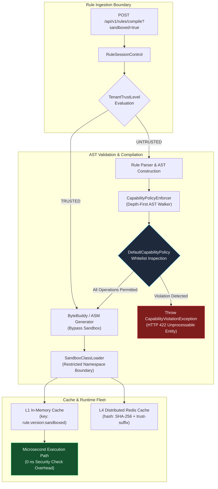
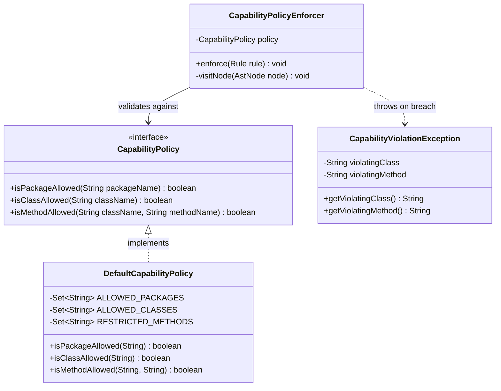
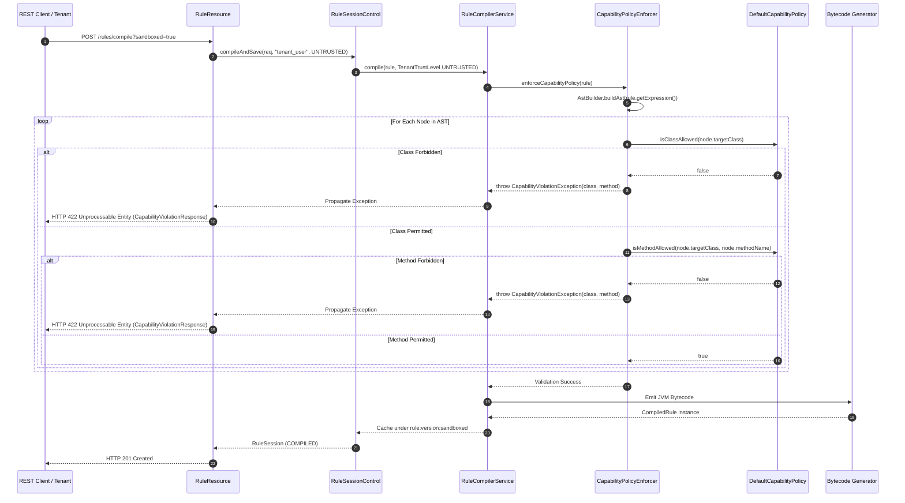
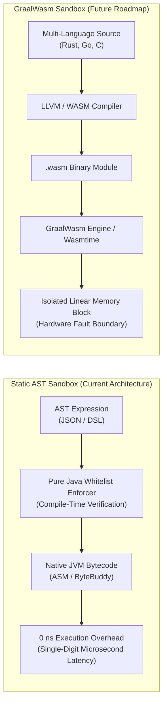

# AST Capability Sandbox

Modern multi-tenant rule engines evaluate dynamic logic authored not only by internal engineering teams, but increasingly by external enterprise tenants, partner developers, and automated policy pipelines. Executing arbitrary client-supplied code on a shared Java Virtual Machine introduces critical security risks: denial of service, resource exhaustion, sensitive file extraction, unauthorized network connections, reflective inspection of JVM internals, and escape to native host processes.

Historically, JVM environments relied on `java.lang.SecurityManager`. However, SecurityManager was formally deprecated for removal in [JEP 411 (Java 17)](https://openjdk.org/jeps/411) due to substantial performance overhead on hot execution paths, brittle permission models, and continuous maintenance burden. Furthermore, standard class loader isolation only isolates static namespace visibility—it does not prevent untrusted bytecode from invoking dangerous standard library methods (such as `System.exit()` or `Runtime.getRuntime().exec()`).

Helix addresses this challenge by introducing an **AST-Level Capability Sandbox**. Rather than inspecting permissions at runtime with every bytecode instruction, Helix enforces security statically over the Abstract Syntax Tree (AST) before bytecode compilation. This provides strict zero-trust isolation with **0 ns execution-time latency overhead**.

---

## 1. Security Architecture & Threat Model



### The Multi-Tenant Threat Model

When multi-tenant rules execute in a pooled JVM instance, untrusted scripts must never be capable of:

1. **Host Compromise**: Spawning native OS processes, executing shell commands, or invoking arbitrary binaries via `ProcessBuilder` or JNI.
2. **Data Exfiltration**: Opening raw TCP/UDP sockets, establishing HTTP connections, or reading host files (`/etc/passwd`, cloud instance metadata tokens).
3. **Engine Subversion**: Terminating the JVM via `System.exit()`, deregistering shutdown hooks, or installing malicious security providers.
4. **Introspection & Escape**: Reflectively accessing private fields, bypassing access controls via `sun.misc.Unsafe` or `MethodHandles.Lookup`, or tampering with sibling tenant session data.
5. **Denial of Service (DoS)**: Manipulating thread groups, spawning uncontrolled virtual threads, or altering system clock and timezone settings.

Helix categorizes all rule compilation requests under two trust domains governed by `TenantTrustLevel`:

| Trust Level | Target Author | Security Checks | Cache Key Namespace |
| :--- | :--- | :--- | :--- |
| `TRUSTED` | Internal systems, platform engineers | Standard type checks, syntax validation | `ruleName:version` |
| `UNTRUSTED` | External tenants, third-party partners | Full AST Capability Policy whitelist verification | `ruleName:version:sandboxed` |

Separating cache keys by trust level ensures that a sandboxed rule and a trusted internal rule with identical identifiers can never suffer from cache poisoning across tenant boundaries.

---

## 2. Restricted Operations Taxonomy

The `DefaultCapabilityPolicy` implements a strict default-deny whitelist. Any AST node attempting to access classes, packages, or methods outside the permissible set immediately causes compilation to fail.



### Classification of Forbidden Operations

The sandbox enforces comprehensive restrictions across six primary vectors:

```
+-------------------------------------------------------------------------+
|                  FORBIDDEN OPERATION TAXONOMY                           |
+-------------------+-----------------------------------------------------+
| Subsystem         | Prohibited Types & Operations                       |
+-------------------+-----------------------------------------------------+
| System Control    | java.lang.System (exit, gc, loadLibrary, getenv)    |
|                   | java.lang.Runtime (exec, halt, addShutdownHook)     |
|                   | java.lang.ProcessBuilder                            |
+-------------------+-----------------------------------------------------+
| Reflection & JNI  | java.lang.reflect.* (Method, Field, Constructor)    |
|                   | java.lang.invoke.* (MethodHandles, VarHandle)       |
|                   | sun.misc.Unsafe, jdk.internal.*                     |
+-------------------+-----------------------------------------------------+
| Filesystem & I/O  | java.io.* (File, FileInputStream, FileOutputStream) |
|                   | java.nio.file.* (Path, Files, FileSystems)          |
+-------------------+-----------------------------------------------------+
| Networking        | java.net.* (Socket, URL, HttpURLConnection)         |
|                   | java.net.http.* (HttpClient)                        |
+-------------------+-----------------------------------------------------+
| Concurrency       | java.lang.Thread (start, stop, interrupt, sleep)    |
|                   | java.lang.ThreadGroup                               |
|                   | java.util.concurrent.* (Executors, ForkJoinPool)    |
+-------------------+-----------------------------------------------------+
| Class Loading     | java.lang.ClassLoader, java.lang.Class.forName      |
+-------------------+-----------------------------------------------------+
```

### The Safe Whitelisted Surface

Untrusted rules are strictly confined to deterministic computational logic:

- **Mathematical Primitives**: Standard arithmetic, comparison, and boolean logic operators.
- **Java Standard Math**: Safe `java.lang.Math` operations (`abs`, `min`, `max`, `sqrt`, `round`, `pow`, `log`, `sin`, `cos`).
- **Context Variables**: Reading named attributes from the incoming `ExecutionContext` (e.g., `transaction.amount`, `user.accountAge`).
- **Safe String Manipulation**: Primitive string operations (`length`, `contains`, `startsWith`, `endsWith`, `toLowerCase`, `trim`).
- **Machine Learning Inference**: Invoking registered machine learning models via the native `ML('model_name')` AST construct (which delegates directly to the sandboxed in-process ONNX Runtime session pool).

---

## 3. Capability Policy Enforcer Mechanics

When an untrusted rule expression is submitted, the compilation pipeline executes the following sequence:



### Isolated SandboxClassLoader

In addition to static AST verification, the compiled class bytes of an untrusted rule are injected into a dedicated `SandboxClassLoader`. This classloader overrides standard parent delegation for restricted packages:

```java
public class SandboxClassLoader extends ClassLoader {
    private final CapabilityPolicy policy;

    public SandboxClassLoader(ClassLoader parent, CapabilityPolicy policy) {
        super(parent);
        this.policy = Objects.requireNonNull(policy, "CapabilityPolicy cannot be null");
    }

    @Override
    protected Class<?> loadClass(String name, boolean resolve) throws ClassNotFoundException {
        // Enforce boundary: prevent dynamic lookup of restricted classes at runtime
        if (!policy.isClassAllowed(name)) {
            throw new SecurityException("Sandbox restricted class resolution: " + name);
        }
        return super.loadClass(name, resolve);
    }
}
```

---

## 4. Enabling Sandboxed Mode via REST API

The Helix Cortex compile endpoint exposes an optional `sandboxed` boolean query parameter:

```http
POST /api/v1/rules/compile?sandboxed=true HTTP/1.1
Host: localhost:8080
Authorization: Bearer <jwt-token>
Content-Type: application/json
```

### Valid Sandboxed Submission (Success)

#### Request Payload
```json
{
  "ruleName": "tenant_volume_discount",
  "ruleVersion": "1.0.0",
  "expression": "orderTotal > 500 && customerType == 'VIP' ? orderTotal * 0.15 : 0.0",
  "inputSchema": {
    "orderTotal": "double",
    "customerType": "string"
  }
}
```

#### Response: `201 Created`
```json
{
  "id": 1042,
  "ruleName": "tenant_volume_discount",
  "ruleVersion": "1.0.0",
  "compiledRuleId": "tenant_volume_discount:1.0.0:sandboxed",
  "status": "COMPILED",
  "engineerId": "external_partner_corp",
  "createdAt": "2026-10-29T10:15:30.125Z"
}
```

### Malicious Sandboxed Submission (Capability Violation)

Consider an untrusted tenant attempting to execute an operating system process:

#### Request Payload
```json
{
  "ruleName": "malicious_escape_attempt",
  "ruleVersion": "1.0.0",
  "expression": "java.lang.System.exit(0) == null",
  "inputSchema": {}
}
```

#### Response: `422 Unprocessable Entity`
The endpoint returns an RFC 7807 problem details response encapsulating structured diagnostic metadata:

```json
{
  "status": 422,
  "title": "Unprocessable Entity",
  "violatingClass": "java.lang.System",
  "violatingMethod": "exit",
  "errorMessage": "Capability violation: Operation 'java.lang.System.exit' is restricted in sandboxed rule execution mode.",
  "detail": "Capability violation: Operation 'java.lang.System.exit' is restricted in sandboxed rule execution mode."
}
```

### cURL Verification Commands

```bash
# 1. Compile a legitimate sandboxed tenant rule
curl -s -X POST "http://localhost:8080/helix-cortex/api/v1/rules/compile?sandboxed=true" \
  -H "Authorization: Bearer $AUTH_TOKEN" \
  -H "Content-Type: application/json" \
  -d '{
    "ruleName": "safe_credit_check",
    "ruleVersion": "1.0.0",
    "expression": "creditScore >= 700 && debtToIncomeRatio < 0.40",
    "inputSchema": {"creditScore": "int", "debtToIncomeRatio": "double"}
  }' | jq .

# 2. Verify rejection of a forbidden runtime command execution
curl -s -X POST "http://localhost:8080/helix-cortex/api/v1/rules/compile?sandboxed=true" \
  -H "Authorization: Bearer $AUTH_TOKEN" \
  -H "Content-Type: application/json" \
  -d '{
    "ruleName": "forbidden_exec",
    "ruleVersion": "1.0.0",
    "expression": "java.lang.Runtime.getRuntime().exec(\"cat /etc/passwd\") != null",
    "inputSchema": {}
  }' | jq .
```

---

## 5. Architectural Roadmap: WebAssembly (WASM) Sandboxing

While static AST inspection delivers optimal performance for JVM-hosted expressions, certain regulated environments require execution of arbitrary multi-language code (e.g., Rust, C++, Go, or Python compiled to WebAssembly bytecode).



### Architectural Trade-Off Analysis

| Architectural Dimension | Helix AST Sandbox (Current) | WebAssembly / GraalWasm (Future Roadmap) |
| :--- | :--- | :--- |
| **Execution Overhead** | **0 ns** (runs as native JVM bytecode) | 15% – 35% interpreter / JIT boundary overhead |
| **Cold Start Latency** | **Microseconds** (< 2 ms parsing & compile) | Tens of milliseconds (WASM module compilation) |
| **Language Support** | Helix Rule DSL, Boolean / Arithmetic expressions | Rust, C, C++, Go, AssemblyScript, Zig |
| **Memory Isolation** | Shared JVM heap (constrained by variable context) | Discrete 32-bit linear address space |
| **Use Case Alignment** | High-throughput fintech, fraud detection, SLA < 50 µs | Complex third-party algorithmic plugins, legacy C libraries |

Helix provides static AST capability sandboxing as the standard default for enterprise rule evaluation, with an extensible architecture designed to seamlessly accommodate GraalWasm modules where multi-language binary isolation is mandated by compliance policies.
